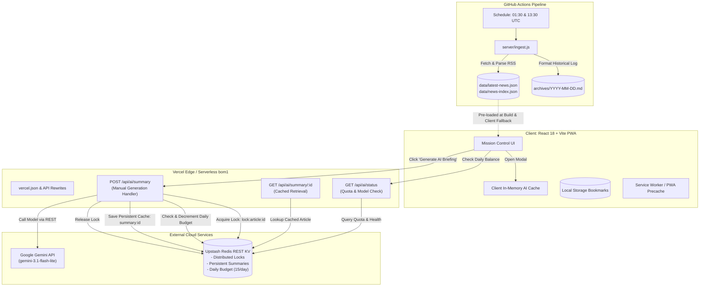

# 🚀 CosmosHub — Space Intelligence Platform

[](https://cosmos-hub-sc.vercel.app)
[](https://github.com/sc-likes-to-code/CosmosHub)
[](https://github.com/sc-likes-to-code/CosmosHub)
[](https://ai.google.dev/)
[](LICENSE)

> **A mission-control space exploration intelligence dashboard and archival platform featuring real-time scientific telemetry, on-demand Gemini AI summaries, Upstash Redis persistent caching and distributed quotas, and an authoritative catalog of 110+ verified space exploration missions.**

- **Live Production URL:** [https://cosmos-hub-sc.vercel.app](https://cosmos-hub-sc.vercel.app)
- **Repository:** [https://github.com/sc-likes-to-code/CosmosHub](https://github.com/sc-likes-to-code/CosmosHub)

---

## 📑 Table of Contents

1. [Platform Overview](#-platform-overview)
2. [Key Capabilities & Features](#-key-capabilities--features)
3. [System Architecture](#-system-architecture)
4. [AI Summarization Engine & Quota Architecture](#-ai-summarization-engine--quota-architecture)
5. [Space Mission Intelligence Archive](#-space-mission-intelligence-archive)
6. [Automated RSS Ingestion & Archival Pipeline](#-automated-rss-ingestion--archival-pipeline)
7. [Environment Variables & Configuration](#-environment-variables--configuration)
8. [Local Development Guide](#-local-development-guide)
9. [Test Suite & Quality Verification](#-test-suite--quality-verification)
10. [Data Sources & Scientific Credibility](#-data-sources--scientific-credibility)
11. [Roadmap](#-roadmap)
12. [License](#-license)

---

## 🌌 Platform Overview

**CosmosHub** is an open-source space intelligence platform combining real-time scientific transmissions with deep historical context. It aggregates feeds from top space exploration agencies and journals worldwide, deduplicates and indexes stories twice daily via automated GitHub Actions, provides on-demand multi-perspective AI summaries via Google Gemini 3.1 Flash-Lite, and maintains an authoritative, cross-referenced archive of human spaceflight, planetary probes, and space observatories.

The platform is engineered for high performance, zero idle cost, and resilience:
- **Frontend:** React 18 SPA built with Vite, styled with a sci-fi "mission control" aesthetic (dark slate/navy, Orbitron headings, cyan highlights, glowing telemetry indicators).
- **Backend:** Native Vercel Serverless Functions (`/api/ai/*`) deployed to Mumbai, India (`bom1`) for minimal regional latency.
- **Persistent State & Cache:** Upstash Redis (REST KV) providing atomic distributed locking, persistent summary storage, and strict calendar-day quota enforcement (IST timezone).
- **Ingestion Pipeline:** Headless GitHub Actions workflow running every 12 hours (01:30 & 13:30 UTC / 07:00 & 19:00 IST), maintaining daily Markdown archives and static JSON feeds.
- **PWA & Offline Capability:** Progressive Web App with service worker caching for offline article reading and archive browsing.

---

## ✨ Key Capabilities & Features

### 1. 📡 Live Scientific Transmission Feed
- Aggregates 10+ verified scientific feeds (NASA, ISRO, ESA, JPL, SpaceNews, Universe Today, Phys.org, Astronomy.com, ArXiv Astrophysics).
- Real-time client-side source and category filtering (`All Transmissions`, `NASA`, `ISRO`, `ESA`, `Missions`, `Deep Space`, `Rocketry`, `Commercial`).
- URL canonicalization and fuzzy headline deduplication to filter duplicate syndications.
- Source credibility ratings, trust indicators, and publication relative timestamps.

### 2. 🧠 On-Demand AI Intelligence Summaries (Gemini 3.1 Flash-Lite)
- **Manual Generation Only:** Zero wasteful background AI calls during feed browsing, page loading, or article modal opening. AI summaries generate only when a user explicitly clicks **"Generate AI Briefing"**.
- **Three Perspective Modes:**
  - **Quick Brief:** 3 concise bullet points focusing on facts and mission relevance.
  - **Detailed Intelligence:** 3 comprehensive thematic paragraphs covering mission background, technical payload/science, and broader exploration impact.
  - **ELI12:** An engaging, accessible explanation without technical jargon.
- **Subtle Quota & Status Gauge:** Displays remaining daily summaries and next reset time.
- **Resilient Fallback:** Automatically falls back to sanitized RSS descriptions if API key is unconfigured or daily quota is reached.

### 3. 🛰️ Space Mission Intelligence Archive
- **110 Standardized, Rich Mission Dossiers:** Spanning NASA Apollo (1–17), NASA Human Spaceflight (Mercury to Artemis), NASA Robotic & Observatories, ISRO (Aryabhata to Gaganyaan & Chandrayaan-4), ESA, JAXA, CNSA, historic Soviet programs, and Commercial NewSpace (SpaceX, CLPS, Axiom).
- **Multi-Faceted Information Architecture:**
  - Instant full-text search across mission names, agencies, descriptions, destinations, rockets, crew, and keywords.
  - Status filters (`Active & Operating`, `In Cruise`, `Upcoming / In-Dev`, `Completed & Historic`, `Human Spaceflight`, `Programme Archives`).
  - Dropdown filtering by Agency, Destination, Category, and Sort order.
  - Interactive **Programme Dossier View** grouping missions into major historical programs (Apollo, Artemis, Chandrayaan, Gaganyaan, Mars Rovers, Voyager, Chang'e, ISS, Great Observatories, Commercial Crew, CLPS).
- **Deep Mission Detail Dossier:**
  - Operational status callout with fact verification as of **October 31, 2026**.
  - Spacecraft technical specifications (manufacturer, launch mass, power architecture).
  - Astronaut & cosmonaut crew rosters.
  - Key scientific objectives and historical achievements.
  - Chronological milestone timeline tracking completed vs current vs upcoming phases.
  - Direct links to verified space agency mission portals.
  - Live CosmosHub intelligence matching linking real-time news articles directly to the mission.

### 4. 🔍 Global Article Search & Bookmarks
- Fast, client-side keyword search indexing headlines and descriptions across current transmissions and persistent archive pools.
- Persistent saved articles stored in `localStorage` with offline reading support.

### 5. ⚡ Breaking Astronomical Ticker
- Real-time scrolling ticker displaying top astronomical headlines, high-priority mission milestones, and solar activity alerts.

---

## 🏗️ System Architecture



---

## 🧠 AI Summarization Engine & Quota Architecture

### Model & Prompt Strategy
- **Default Model:** `gemini-3.1-flash-lite` (configurable via `GEMINI_MODEL`).
- **Prompt Engineering:** Structured single-pass prompt instructing Gemini to return valid, raw JSON with `short`, `detailed`, and `eli12` properties:
  ```json
  {
    "short": "• Three crisp bullet points...",
    "detailed": "Three thematic paragraphs covering context, science payload, and mission significance...",
    "eli12": "An accessible, engaging explanation..."
  }
  ```

### Strict Quota Accounting & IST Reset Cycle
- **Allowance:** 15 newly generated summaries per calendar day (configurable via `DAILY_SUMMARY_BUDGET`).
- **Timezone Anchor:** Enforced in Indian Standard Time (**UTC+05:30 / Asia/Kolkata**). Daily counter automatically expires at 00:00:00 IST using Redis `EXPIREAT`.
- **Atomic Operations:** Counters use Redis `INCR` and `DECR` commands ensuring no race conditions or overruns under concurrent requests.
- **Cache Hits Consume 0 Quota:** Once an article is summarized, it is stored indefinitely in Upstash Redis (`summary:<articleId>`). Subsequent views by any user consume zero Gemini tokens and zero quota budget.

### Distributed Concurrency Locking
- Before generating a summary, instances acquire a distributed Redis lock:
  `SET lock:summary:<articleId> <instanceToken> NX EX 45`
- Prevents concurrent Vercel serverless function executions from generating duplicate summaries for the same article simultaneously.
- When an in-flight request is detected, other instances await the result and retrieve the completed summary from Redis.

### Intelligent Provider Error Classification
- **Gemini Overload (503 / High Demand):** When Google's API returns `503 Service Unavailable`, `RESOURCE_EXHAUSTED`, or messages containing `"high demand"`, the backend detects this as a non-fault provider failure and **automatically releases the reserved daily quota** back to the budget.
- **Ambiguous Timeouts (Client/Socket):** To prevent quota evasion, network drops or unconfirmed gateway timeouts retain quota reservations.

---

## 🛰️ Space Mission Intelligence Archive

The Space Mission Intelligence Archive provides an exhaustive catalog of **110 verified space missions** and **11 major exploration programmes**:

| Programme / Agency | Cataloged Missions | Status Highlights |
| :--- | :--- | :--- |
| **Apollo Programme (NASA)** | Apollo 1 through Apollo 17 (16 missions) | Complete flight-by-flight historical dossier including launch dates, crews, landing sites, and rock sample weights. |
| **Artemis Programme (NASA/ESA/JAXA/ISRO)** | Artemis I, Artemis II, Artemis III, Artemis IV, Lunar Gateway | **Artemis II** verified as completed crewed lunar flyby in 2026; Orion life support and deep-space trajectory certified. |
| **Chandrayaan Programme (ISRO)** | Chandrayaan-1, Chandrayaan-2, Chandrayaan-3, Chandrayaan-4 | **Chandrayaan-3** verified completed at Shiv Shakti Point (69.37° S) with sulfur discovery and hop test; Chandrayaan-4 in active multi-module development. |
| **Gaganyaan Programme (ISRO)** | TV-D1, G1 (Uncrewed / Vyommitra), H1 (First Crewed) | Flight abort qualification completed; astronaut designates undergoing advanced simulations for 400 km orbital mission. |
| **Mars Exploration Rovers (NASA)** | Pathfinder/Sojourner, Spirit, Opportunity, Curiosity, Perseverance, Ingenuity | **Curiosity** ascending Gediz Vallis; **Perseverance** coring Jezero rim bedrock; **Ingenuity** retired after 72 historic flights. |
| **Outer Planets & Heliophysics** | Pioneer 10/11, Voyager 1/2, Galileo, Cassini, Juno, New Horizons, Parker Solar Probe, Europa Clipper | **Voyager 1 & 2** active in interstellar space; **Europa Clipper** in interplanetary cruise; **Parker Solar Probe** touching the solar corona. |
| **Great Observatories & Astrophysics** | Hubble, JWST, Chandra, TESS, Kepler, Roman Space Telescope | **JWST** operating at Sun-Earth L2 discovering earliest galaxies at cosmic dawn; **Hubble** operating on single-gyro mode; **Roman** in environmental integration. |
| **International (ESA / JAXA / CNSA / Soviet)** | Rosetta, Gaia, Euclid, JUICE, Hera, SLIM, Chang'e 4/6, Tianwen-1, Sputnik, Vostok 1 | **Gaia** science concluded in 2025 (DR4 processing); **SLIM** pinpoint landing at Shioli crater; **Chang'e 6** historic farside sample return completed June 2024. |
| **Commercial & CLPS** | SpaceX Demo-2, Starship IFT, IM-1 Odysseus, Astrobotic Peregrine, Axiom-1 | **Starship** Super Heavy booster catch by Mechazilla; **IM-1 Odysseus** first commercial lunar landing. |

### Mission Data Schema
Every mission record adheres to a strict, typed schema in `src/data/missions.js`:
```typescript
interface MissionRecord {
  id: string;                         // Unique kebab-case ID (e.g. 'chandrayaan-3')
  name: string;                       // Primary mission name
  alternateNames?: string[];          // Aliases (e.g. ['LVM3-M4'])
  programme: string;                  // Parent programme display name
  programmeId: string;                // Parent programme ID (e.g. 'chandrayaan')
  agency: string;                     // Lead agency (e.g. 'ISRO')
  partnerAgencies?: string[];         // Collaborating agencies
  category: string;                   // 'Robotic Exploration' | 'Human Spaceflight' | 'Space Observatories' | 'Earth Observation'
  destination: string;                // Target destination (e.g. 'Moon', 'Mars', 'Sun')
  status: 'active' | 'extended' | 'cruise' | 'upcoming' | 'in-development' | 'completed' | 'retired' | 'failed';
  launchDate: string;                 // ISO date (YYYY-MM-DD)
  endDate?: string | null;            // ISO date or null if ongoing
  launchVehicle?: string;             // Booster rocket (e.g. 'LVM3', 'Falcon Heavy')
  missionType?: string;               // High-level designation
  missionDuration?: string;           // Elapsed duration
  description: string;                // Overview dossier paragraph
  scientificObjectives: string[];     // Bulleted scientific aims
  keyAchievements: string[];          // Major milestone accomplishments
  milestones: Array<{                 // Chronological timeline
    label: string;
    date: string;
    done: boolean;
    current?: boolean;
  }>;
  crew?: Array<{ name: string; role: string }> | null;
  spacecraft?: {
    type?: string;
    manufacturer?: string;
    massKg?: number;
    powerSource?: string;
  };
  currentOperationalStatus: string;   // Real-time factual status verified to 2026-10-31
  historicalSignificance?: string;    // Long-term historical context
  latestKnownUpdate?: string;         // Recent telemetry intelligence
  lastVerifiedAt: string;             // '2026-10-31'
  officialSourceUrl?: string;         // Space agency portal link
  relatedNewsTags?: string[];         // Keyword tokens for live feed matching
  tags?: string[];                    // Search tags
}
```

---

## 🔄 Automated RSS Ingestion & Archival Pipeline

CosmosHub includes a scheduled data ingestion engine located in `server/ingest.js` driven by GitHub Actions (`.github/workflows/ingest.yml`):
- **Schedule:** Triggers twice daily at `01:30 UTC` (07:00 IST) and `13:30 UTC` (19:00 IST).
- **RSS Parsing & Sanitation:** Concurrently polls all feeds with 8-second request timeouts, sanitizes raw HTML summaries, strips advertising tags, and extracts high-resolution thumbnails.
- **Deduplication:** Normalizes source tracking parameters and computes deterministic SHA-256 identity hashes to prevent duplicate entries across feeds.
- **Static Artifact Generation:**
  - `data/latest-news.json`: Top 60 current stories pre-rendered for instant page load.
  - `data/news-index.json`: Master searchable index of recent space dispatches.
  - `archives/YYYY-MM-DD.md`: Permanent, human-readable daily Markdown intelligence log committed to the repository.

---

## 🔐 Environment Variables & Configuration

Create a `.env` file in the root directory for local development or configure these variables in the **Vercel Project Settings**:

| Variable Name | Required | Default | Description |
| :--- | :---: | :--- | :--- |
| `GEMINI_API_KEY` | **Yes** (for AI) | None | Google AI Studio API key for Gemini models. |
| `UPSTASH_REDIS_REST_KV_REST_API_URL` | **Yes** (Vercel) | None | REST API URL from Vercel Upstash integration (e.g. `https://...upstash.io`). |
| `UPSTASH_REDIS_REST_KV_REST_API_TOKEN` | **Yes** (Vercel) | None | Write-capable REST API token from Vercel Upstash integration. |
| `UPSTASH_REDIS_REST_URL` | Optional | Fallback | Alternative variable name for Upstash REST URL. |
| `UPSTASH_REDIS_REST_TOKEN` | Optional | Fallback | Alternative variable name for Upstash write token. |
| `GEMINI_MODEL` | Optional | `gemini-3.1-flash-lite` | Target Gemini model identifier. |
| `DAILY_SUMMARY_BUDGET` | Optional | `15` | Maximum newly generated summaries permitted per IST calendar day. |
| `VERCEL_REGION` | Optional | `bom1` | Target serverless deployment region (Mumbai recommended). |
| `PORT` | Optional | `3001` | Express server port for local backend emulation. |

> [!NOTE]
> In local development without Upstash Redis or Gemini configured, CosmosHub operates smoothly in offline-fallback mode, returning sanitized RSS descriptions and local mock responses.

---

## 💻 Local Development Guide

### Prerequisites
- **Node.js:** v18.0.0 or higher (v20+ recommended).
- **Package Manager:** npm (installed with Node).

### Installation & Startup

1. **Clone the repository:**
   ```bash
   git clone https://github.com/sc-likes-to-code/CosmosHub.git
   cd CosmosHub
   ```

2. **Install dependencies:**
   ```bash
   npm install
   ```

3. **Configure environment:**
   ```bash
   cp .env.example .env
   # Add your GEMINI_API_KEY and Upstash credentials if testing AI generation locally
   ```

4. **Launch development environment:**
   ```bash
   # Option A: Start frontend with Vite (uses client-side fallback / proxy)
   npm run dev

   # Option B: Start local Express emulation server
   npm run server

   # Option C: Start full-stack local dev (frontend + Express)
   npm run fullstack
   ```

5. **Open in browser:**
   Navigate to [http://localhost:5173](http://localhost:5173).

---

## 🧪 Test Suite & Quality Verification

CosmosHub includes an automated test suite executed with Node's native test runner (`node:test` and `node:assert/strict`):

```bash
# Run all unit and integration test suites
npm test

# Run only the mission intelligence archive suite
node --test tests/mission-archive.test.js

# Run frontend AI integration tests
node --test tests/frontend-ai-integration.test.js

# Build production bundle
npm run build
```

### Verified Test Suites (109 Tests Across 20 Suites Passing Cleanly):
- ✅ `tests/mission-archive.test.js`: Validates schema integrity, unique IDs, chronological milestones, crew arrays, factual accuracy across 110 records, and search/filter logic.
- ✅ `tests/frontend-ai-integration.test.js`: Verifies client-side caching, manual-only trigger policy, 429 rate limit handling, daily budget exhaustion, and zero unexpected API calls.
- ✅ `tests/gemini-infrastructure.test.js`: Verifies model configuration, distributed locking, atomic quota increment/decrement, and provider 503 overload classification.
- ✅ `tests/ingest-pipeline.test.js`: Validates URL canonicalization, deduplication, time zone conversions, and idempotent daily archive generation.
- ✅ `tests/search-and-bookmarks.test.js`: Tests multi-word search matching, relevance ranking, and bookmark persistence.

---

## 🛰️ Data Sources & Scientific Credibility

CosmosHub relies exclusively on verified institutional space agency communications, peer-reviewed preprint servers, and accredited aerospace journalism:

- **NASA:** News Releases, Artemis Updates, and Jet Propulsion Laboratory (JPL) Mission Dispatches.
- **ISRO:** Official Press Releases, Launch Notifications, and Chandrayaan/Aditya telemetry updates.
- **ESA:** European Space Agency News and Operations bulletins.
- **SpaceNews:** Global commercial, military, and policy aerospace journalism.
- **Universe Today:** Deep-sky discoveries, exoplanet surveys, and observational astronomy.
- **Phys.org & Astronomy.com:** Astrophysics, solar physics, and cosmological research announcements.
- **ArXiv Astrophysics (`astro-ph`):** Cutting-edge academic preprints across cosmology, stellar astrophysics, and planetary systems.

---

## 🗺️ Roadmap

### Current Production Release (`v2.0.0`)
- [x] Full Vercel Serverless Function architecture for AI endpoints (`/api/ai/*`).
- [x] Upstash Redis distributed locking, persistent summary cache, and IST-anchored quota counter.
- [x] Gemini 3.1 Flash-Lite multi-mode summarization (Quick Brief, Detailed Intelligence, ELI12).
- [x] Automatic 503 overload error detection and quota refunding.
- [x] Space Mission Intelligence Archive upgraded to **110 verified records** across 11 major programs.
- [x] Mission detail drawer with spacecraft specs, crew rosters, milestones, and live news matching.
- [x] Full-text search and multi-faceted filtering (Status, Category, Agency, Destination, Sort).
- [x] PWA offline caching and installation support.

### Planned Enhancements
- [ ] **Interactive 3D Orbit Visualizer:** WebGL / Three.js solar system trajectory view for active cruise missions (BepiColombo, JUICE, Europa Clipper).
- [ ] **Live Launch Countdown Clock:** Real-time countdown cards for upcoming orbital flights and astronaut launches.
- [ ] **Custom Notification Hooks:** Web push notifications for major solar flare events or breaking space discoveries.
- [ ] **Community Mission Annotations:** Verified user insights and amateur astronomy telescope observation links.

---

## 📄 License

This project is licensed under the **MIT License** — see the [LICENSE](LICENSE) file for details.

Developed with 🔭 for space enthusiasts, astrophysicists, and engineers exploring our universe.
